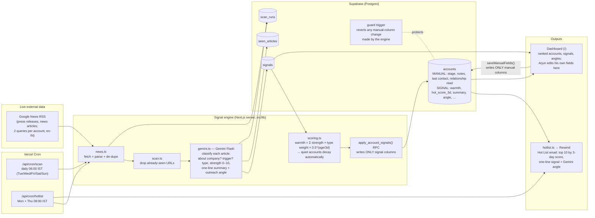

# Components Map — B2B Account Signal Monitor

High-res: [PNG](docs/components-map.png) · [SVG](docs/components-map.svg). Mermaid version below.

## Components

| # | Component | Tech | Responsibility |
|---|---|---|---|
| 1 | Scheduler | Vercel Cron (`vercel.json`) | Daily scan; Mon/Thu scan + Hot List email |
| 2 | News collector | `src/lib/news.ts`, Google News RSS | Live articles per account: a broad query plus a trigger-keyword query (hiring, CHRO, funding, expansion, attrition, digitalisation…) |
| 3 | De-duplication | `signals` + `seen_articles` tables | Each article is sent to Gemini at most once |
| 4 | AI classifier + angle writer | `src/lib/gemini.ts`, **Gemini Flash** (structured JSON output) | Is it about this company? Is it a trigger? Type, strength, one-line summary; stage-aware outreach angle tied to the product |
| 5 | Scoring | `src/lib/scoring.ts` | Time-decayed warmth (3-day half-life) and a 3-day hot score, so quiet accounts sink automatically |
| 6 | Safe write-back | `apply_account_signals` RPC + `protect_manual_columns` trigger | The system can update only signal-derived columns; Arjun's notes, last-contact date, stage and relationship read cannot be changed by the engine |
| 7 | Hot List email | `src/lib/hotlist.ts`, Resend | Top 10 accounts by 3-day signal strength, each with the signal, the angle and source links |
| 8 | Dashboard | `src/app/page.tsx` (Next.js, basic auth) | Ranked view; "Scan now" / "Send Hot List now"; Arjun edits only his own fields |
| 9 | Audit log | `scan_runs` table | Every run: articles fetched, new signals, errors, email sent |

## Column ownership (the core guarantee)

| Owner | Columns | Written by |
|---|---|---|
| **Arjun** | `stage`, `owner_notes`, `last_contact_date`, `relationship_read` | Dashboard form only (`saveManualFields`, explicit allow-list) |
| **System** | `warmth_score`, `hot_score_3d`, `signal_count_3d`, `top_signal_type`, `signal_summary`, `outreach_angle`, `last_signal_at`, `signals_updated_at` | `apply_account_signals` RPC only |

Even if the engine code tried to write a manual column, the Postgres trigger would put the old value back.
