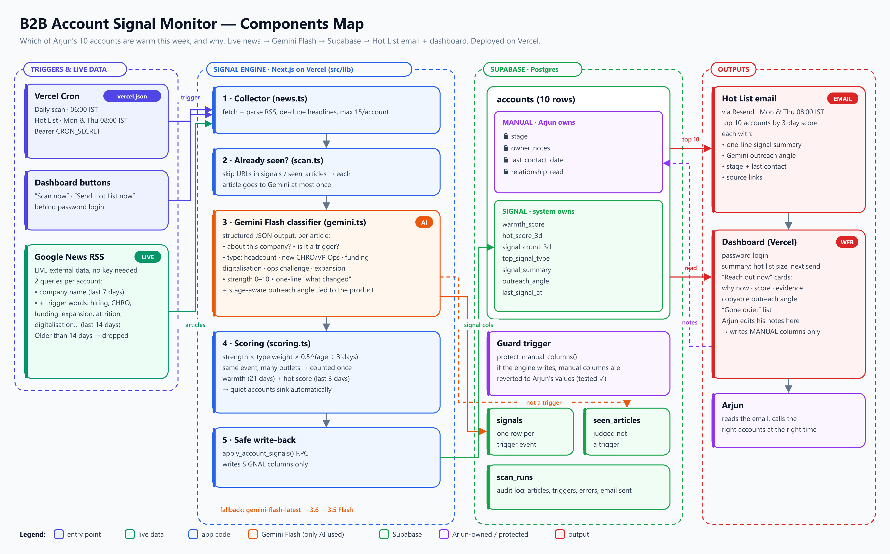

# B2B Account Signal Monitor

This tool tells Arjun which of his accounts are warm this week and why. It scans live news for trigger events (headcount expansion, a new CHRO or VP Ops, workforce digitalisation, funding, operational challenges, expansion), scores each account with time decay, and emails a **Hot List** every Monday and Thursday at 08:00 IST. Each entry in the Hot List includes an outreach angle drafted by Gemini Flash.

The system writes only to signal-derived columns. Arjun's notes, last-contact dates, stage and relationship read are protected at the database level. See [COMPONENTS.md](COMPONENTS.md) for the Components Map.

## Stack
Next.js 15 on Vercel · Supabase (Postgres) · Gemini Flash (`@google/genai`) · Google News RSS (live data) · Resend (email) · Vercel Cron

## Setup
1. **Supabase**: create a project. In the SQL Editor, run `supabase/schema.sql` and then `supabase/seed.sql`.
2. **Keys**: copy `.env.example` to `.env.local` and fill it in.
3. **Run locally**: run `npm install`, then `npm run dev`. Open http://localhost:3000 and click **Scan now**.
4. **Deploy**: push to GitHub and import the repo in Vercel. Add the same env vars in Vercel. The crons in `vercel.json` register automatically.

## Endpoints
- `GET /api/cron/scan` runs a daily scan and re-score. It needs the header `Authorization: Bearer $CRON_SECRET`.
- `GET /api/cron/hotlist` runs a scan and then sends the Hot List email. It needs the same header.

## How "warm" is computed
Each article is sent to Gemini at most once. Gemini returns `about_company`, `is_trigger`, `signal_type`, `strength (0–10)` and a one-line summary. Signals with strength ≥ 4 count toward the score:

    contribution = strength × type_weight × 0.5^(age_days / 3)
    score        = 100 × (1 − e^(−Σ contribution / 8))

The **warmth score** uses the last 21 days, and the dashboard is sorted by it. The **3-day hot score** uses only the last 3 days and ranks the email. An account with no new signals loses half its weight every 3 days, so quiet accounts drop down the list automatically.
